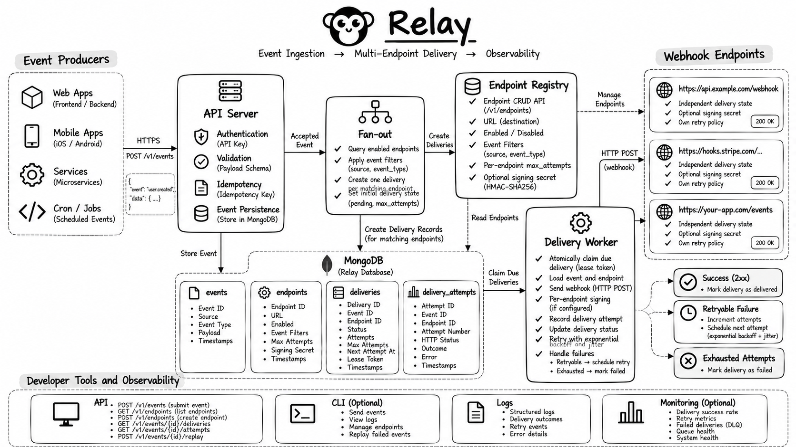

 <p align="center">
  
</p>

<h1 align="center">Relay</h1>

<p align="center">
  Reliable webhook delivery infrastructure for modern applications.
</p>

<p align="center">
  <a href="https://github.com/rajputomsingh/relay/releases"></a>
  <a href="https://www.npmjs.com/package/@rajputomsingh/relay-node"></a>
  <a href="https://pypi.org/project/relay-python-sdk/"></a>
  <a href="https://github.com/rajputomsingh/relay"></a>
<a href="https://github.com/rajputomsingh/relay/blob/main/LICENSE"></a>
<a href="https://github.com/rajputomsingh/relay/stargazers"></a>
  <a href="https://github.com/rajputomsingh/relay/network/members"></a>
</p>

<p align="center">
  
  
  
</p>

> **Release status:** The latest published release is **v1.1.0 - Operational Visibility** ([release tag](https://github.com/rajputomsingh/relay/releases/tag/v1.1.0)). The `main` branch tracks stable development.

Relay is an open-source webhook delivery infrastructure project built with Go and MongoDB. It accepts events over HTTP, persists them reliably, and delivers them asynchronously to matching webhook endpoints with retries, delivery tracking, and replay.

Ingestion and delivery are separate stages, keeping the ingest path fast and predictable while the delivery engine independently handles backoff, concurrency limits, and recovery.

- **Runtime:** Go
- **Persistence:** MongoDB 7 (Go Driver v2)
- **Delivery:** Bounded workers, retries with backoff, per-endpoint state
- **Operations:** Delivery history, health checks, Prometheus and Grafana dashboards
- **API:** OpenAPI specification with interactive Swagger documentation
- **SDKs:** Official Node.js/TypeScript and Python clients

## Built in the open

Relay is an open-source project welcoming contributions from developers interested in Go, distributed systems, webhook infrastructure, and reliability engineering.

**Looking for a place to start?**

- [`good first issue`](https://github.com/rajputomsingh/relay/labels/good%20first%20issue) → 1 to 4 hour tasks, no prior context needed
- [`help wanted`](https://github.com/rajputomsingh/relay/labels/help%20wanted) → needs architectural understanding
- [`advanced`](https://github.com/rajputomsingh/relay/labels/advanced) → for experienced contributors

Read [CONTRIBUTING.md](CONTRIBUTING.md) to set up your environment in under 30 minutes.

**Ideas we would love contributions for:** webhook verification examples, Docker troubleshooting guides, and integration tests for retry logic.

---

## Contributors

<a href="https://github.com/rajputomsingh/relay/graphs/contributors">
  
</a>

_Made with [contrib.rocks](https://contrib.rocks)._

---

## Quick Start

### Docker (Recommended)

The fastest way to get Relay running locally is with Docker Compose:

```bash
git clone https://github.com/rajputomsingh/relay.git
cd relay
make docker-up
```

See [docs/deployment.md](docs/deployment.md) for production configuration details.

### Manual Setup

```bash
git clone https://github.com/rajputomsingh/relay.git
cd relay
go mod download
```

Configure `.env` from `.env.example` (see [Configuration](#configuration)), then:

```bash
go run ./cmd/relay
```

Validate changes with the full gate:

```bash
go test ./...
go vet ./...
go build ./...
git diff --check
```

## Official SDKs

### Node.js / TypeScript

Install the official SDK to integrate Relay into your Node.js or Next.js application:

```bash
npm install @rajputomsingh/relay-node

# or
pnpm add @rajputomsingh/relay-node
```

**Usage:**

```typescript
import { Relay } from "@rajputomsingh/relay-node";

const relay = new Relay({ apiKey: "your-api-key" });

await relay.sendEvent(
  {
    source: "my-app",
    event_type: "user.created",
    data: { userId: 123 },
  },
  "idempotency-key-123",
);
```

Package: [@rajputomsingh/relay-node on npm](https://www.npmjs.com/package/@rajputomsingh/relay-node)

### Python

Install the official Python SDK:

```bash
pip install relay-python-sdk
```

Package: [relay-python-sdk on PyPI](https://pypi.org/project/relay-python-sdk/)

## Architecture

<p align="center">
  
</p>

Each accepted event flows through five stages:

1. **Ingestion.** `POST /v1/events` authenticates the caller, validates the JSON body, and enforces `Idempotency-Key`.
2. **Persistence.** Events are written to MongoDB before any delivery begins. Each matching endpoint gets an independent delivery record.
3. **Matching and scheduling.** Enabled endpoints are filtered by `source` and `event_type`. Matching deliveries enter the pending pool.
4. **Bounded delivery workers.** Workers claim deliveries with lease tokens, execute the outbound HTTP request, and record the attempt.
5. **Outcome and recovery.** Attempts resolve to success, retry with backoff, or terminal failure. Expired leases are reclaimed; terminal failures are eligible for replay.

## Delivery Semantics

Relay provides **at-least-once delivery**. It does **not** guarantee exactly-once processing - a successful HTTP response plus a persisted attempt record cannot jointly guarantee a single downstream effect.

Any downstream system requiring single-effect semantics must implement idempotency using the event `id`.

- **Idempotency keys.** The `Idempotency-Key` header rejects duplicate submissions of the same logical event. It prevents duplicate ingestion; it does not prevent duplicate delivery attempts.
- **Retry classification.** Relay retries `5xx`, network errors, connection refusals, and timeouts. `4xx` responses other than `408` and `429` are terminal.
- **Worker crash.** If a worker dies mid-attempt, its lease expires and the delivery is reclaimed. The retry after reclamation is logged as a new attempt. Downstream systems may receive a delivery more than once.
- **Lease fencing.** A stale worker attempting to record an outcome after its lease is reclaimed is rejected, preventing stale results from overwriting current state.
- **Downstream idempotency.** Because duplicate delivery is possible, downstream handlers must be idempotent.

## Configuration

Relay is configured through environment variables, read at startup. Validation failures abort the process.

| Variable                       | Required | Default       | Notes                                    |
| ------------------------------ | -------- | ------------- | ---------------------------------------- |
| `APP_ENV`                      | No       | `development` | `development` / `staging` / `production` |
| `PORT`                         | No       | `8080`        | Valid TCP port                           |
| `MONGODB_URI`                  | Yes      | —             | Must parse as a MongoDB URI              |
| `MONGODB_DATABASE`             | No       | `relay`       | Non-empty                                |
| `RELAY_API_KEY`                | Yes      | —             | Minimum length of 32 characters          |
| `RELAY_WEBHOOK_URL`            | No       | —             | First-run bootstrap only                 |
| `RELAY_WEBHOOK_SIGNING_SECRET` | No       | —             | If set, at least 32 characters           |

`.env` and files containing credentials must never be committed. In production, source credentials from a secrets manager.

## API Contract & Documentation

All `/v1/*` routes require:

```http
Authorization: Bearer <RELAY_API_KEY>
```

Relay includes an interactive Swagger UI. When running the server locally, navigate to:

👉 **http://localhost:8080/swagger/index.html**

| Method   | Endpoint                     | Auth | Purpose                           |
| -------- | ---------------------------- | ---- | --------------------------------- |
| `GET`    | `/healthz`                   | No   | Liveness (process running)        |
| `GET`    | `/readyz`                    | No   | Readiness (MongoDB reachable)     |
| `GET`    | `/metrics`                   | Yes  | Prometheus metrics endpoint       |
| `POST`   | `/v1/events`                 | Yes  | Submit an event                   |
| `POST`   | `/v1/events/{id}/replay`     | Yes  | Replay an eligible failed event   |
| `POST`   | `/v1/endpoints`              | Yes  | Register an endpoint              |
| `GET`    | `/v1/endpoints`              | Yes  | List endpoints                    |
| `GET`    | `/v1/endpoints/{id}`         | Yes  | Retrieve one endpoint             |
| `PATCH`  | `/v1/endpoints/{id}`         | Yes  | Update endpoint configuration     |
| `DELETE` | `/v1/endpoints/{id}`         | Yes  | Disable an endpoint (soft delete) |
| `GET`    | `/v1/events/{id}/deliveries` | Yes  | Per-endpoint delivery status      |
| `GET`    | `/v1/events/{id}/attempts`   | Yes  | Attempt history                   |

## Webhook Signing

When an endpoint has a signing secret, Relay signs outbound requests with `HMAC-SHA256` over the raw request body and sends the hexadecimal digest in `X-Relay-Signature`.

### Verify in Go

```go
func verifyRelaySignature(rawBody []byte, header string, secret []byte) error {
    if header == "" {
        return errors.New("missing X-Relay-Signature")
    }

    mac := hmac.New(sha256.New, secret)
    mac.Write(rawBody)

    expected := hex.EncodeToString(mac.Sum(nil))

    if !hmac.Equal([]byte(header), []byte(expected)) {
        return errors.New("signature mismatch")
    }

    return nil
}
```

### Verify in Node.js

```js
function verifyRelaySignature(rawBody, header, secret) {
  if (!header) throw new Error("missing X-Relay-Signature");

  const expected = crypto
    .createHmac("sha256", secret)
    .update(rawBody)
    .digest("hex");

  const a = Buffer.from(header, "utf8");
  const b = Buffer.from(expected, "utf8");

  if (a.length !== b.length || !crypto.timingSafeEqual(a, b)) {
    throw new Error("signature mismatch");
  }
}
```

Verify the signature against the **raw request body before parsing or transforming the payload**.

## Operations & Observability

- **Health.** `/healthz` returns `200` while the process runs. `/readyz` returns `200` only when MongoDB responds to ping.
- **Metrics.** `/metrics` exposes Prometheus metrics for outbound delivery duration and delivery attempt outcomes.
- **Dashboards.** A pre-provisioned Grafana dashboard and Prometheus configuration are included in `docker-compose.monitoring.yml`.
- **Shutdown.** On `SIGINT` or `SIGTERM`, Relay stops accepting new requests, drains in-flight deliveries up to the shutdown deadline, then exits.
- **Retry policy.** Backoff is `retryDelay(n) = 2s × 2^(n-1) + jitter(0–25%)`, capped per delay and bounded by `max_attempts`.

## Benchmarks

Relay includes a benchmark harness for sustained load, concurrency, failure modes, outage recovery, and queue growth.

Full methodology and raw results: [docs/benchmarks.md](docs/benchmarks.md).

| Measurement                 | Result            |
| --------------------------- | ----------------- |
| Workload                    | 5,000 deliveries  |
| Highest tested concurrency  | 32                |
| Highest reported throughput | 43.5 deliveries/s |
| Highest-concurrency drain   | 115 s             |

These figures are environment-specific benchmark results, not universal performance guarantees.

## Known Limitations

- Metrics currently query MongoDB on scrape. For very high-throughput setups, an in-memory metrics aggregator is recommended.
- No tenant isolation or per-tenant authorization (single-tenant instance per deployment).
- No web UI for event inspection, monitoring, or replay (API-only).

## Project Status and Roadmap

### Completed (v1.0.0 and v1.1.0)

- Production-ready Dockerfile and Compose setup.
- Prometheus metrics instrumentation and Grafana dashboards.
- OpenAPI (Swagger) interactive documentation.
- Hardened CI/CD pipeline.
- Official Node.js/TypeScript SDK.
- Official Python SDK.

### Planned (v1.2.0+)

- Tenant isolation and multi-tenant authorization.
- Web dashboard for event inspection and replay.
- Go SDK.
- Expanded integration and end-to-end test coverage.
- Further performance and observability improvements.

## Development and Testing

**Unit tests (no infrastructure):**

```bash
go test ./internal/config ./internal/security ./internal/handlers -count=1
```

**Integration tests (MongoDB required):**

```bash
export MONGODB_TEST_URI="mongodb://localhost:27017"
go test ./internal/delivery -count=1
```

**Full validation gate (before proposing changes):**

```bash
go test ./...
go vet ./...
go build ./...
git diff --check
```

## Contributing

Relay is built in the open and welcomes contributions from developers of all experience levels. Whether you're fixing a typo, adding a test, or implementing a new feature, every contribution helps improve the project.

**Quick links:**

- **[Good first issues](https://github.com/rajputomsingh/relay/labels/good%20first%20issue)** → 1 to 4 hour tasks, no prior context needed.
- **[Help wanted](https://github.com/rajputomsingh/relay/labels/help%20wanted)** → issues that need architectural understanding.
- **[Advanced issues](https://github.com/rajputomsingh/relay/labels/advanced)** → for experienced contributors.
- **[Discussions](https://github.com/rajputomsingh/relay/discussions)** → ask questions, share ideas, and propose designs.
- **[CONTRIBUTING.md](CONTRIBUTING.md)** → environment setup, code style, and pull request guidance.

**How to get started:**

1. Find an issue you want to work on.
2. Comment that you'd like to take it so maintainers and other contributors know it's being worked on.
3. Fork the repository and create a focused branch.
4. Follow [Conventional Commits](https://www.conventionalcommits.org/) for your commit messages.
5. Run the validation gate:

   ```bash
   go test ./... && go vet ./... && go build ./... && git diff --check
   ```

6. Open a pull request describing the change, its motivation, and the tests performed.

**Not sure where to start?**

Open a [discussion](https://github.com/rajputomsingh/relay/discussions) or comment on an issue. We welcome questions and are happy to help scope a first contribution.

## License

Licensed under the Apache License 2.0. See [LICENSE](LICENSE) for details.
