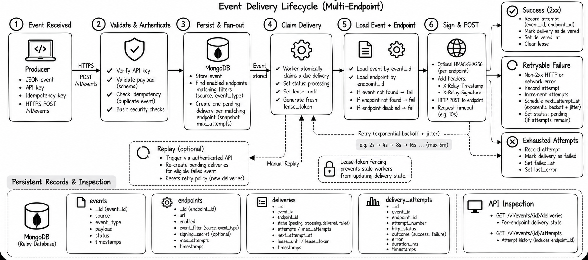

<p align="center">
  
</p>

<h1 align="center">Relay</h1>

<p align="center">
  Reliable webhook delivery for modern applications.
  <br />
  Built with Go and MongoDB to handle event ingestion, retries, delivery tracking, and replay.
</p>

<p align="center">
  <a href="https://github.com/rajputomsingh/relay/stargazers"></a>
  <a href="https://github.com/rajputomsingh/relay/blob/main/LICENSE"></a>
  
  
</p>

> **Release status:** The latest published release shown in GitHub is **v0.4.0 - Multi-Endpoint Delivery**.
> `main` contains subsequent development, including per-endpoint rate limiting and the v0.9.0 load, capacity, and recovery validation milestone. These later capabilities are present on `main` but are not part of the v0.4.0 release artifact.

## Overview

Webhook delivery is a distributed systems problem. Network failures, unavailable endpoints, duplicate requests, and ambiguous delivery outcomes make reliable event propagation difficult to implement independently in every application.

Relay centralizes this responsibility. Applications submit events to Relay, which persists accepted events and manages downstream delivery, retry scheduling, failure tracking, and replay.

The system is designed to separate event ingestion from delivery execution while maintaining persistent records of event state and delivery attempts.

### Architecture

<p align="center">
  
</p>

The flow is: **event ingestion → persistent storage → endpoint matching → delivery workers → retries with attempt history → replay**. Attempts, retries, and endpoint state are all persisted in MongoDB so that the delivery engine can recover its position after a restart.

### Core Capabilities

- **Ingestion:** Authenticated JSON event ingestion over HTTP.
- **Idempotency:** Duplicate-submission protection through idempotency keys.
- **Persistence:** MongoDB storage for events and delivery-attempt history.
- **Delivery:** Asynchronous webhook delivery through Go workers.
- **Multi-Endpoint Delivery:** Independent delivery state for each matching endpoint.
- **Retries:** Exponential backoff with jitter and bounded attempts.
- **Concurrency Control:** Bounded worker concurrency and backpressure.
- **Rate Limiting:** Per-endpoint delivery rate controls.
- **Webhook Signing:** Optional HMAC-SHA256 signatures for outbound requests.
- **Failure Recovery:** Lease recovery, dead-letter handling, and eligible-event replay.
- **Replay:** Manual replay of eligible failed events.
- **Worker Health:** Visibility into delivery execution and operational health.
- **Observability:** Persistent attempt outcomes, durations, HTTP statuses, and errors.
- **Operations:** Liveness, database readiness, and graceful shutdown.
- **Capacity Testing:** Benchmark tooling for concurrency, downstream outages, queue growth, and recovery.

### Delivery Lifecycle

Relay validates and persists incoming events before processing downstream delivery. Each attempt updates delivery state and records its outcome. Failed deliveries are retried according to the configured policy; eligible failed events can be replayed manually.

<p align="center">
  
</p>

## Technology Stack

| Component       | Technology                                                                                                                       |
| --------------- | -------------------------------------------------------------------------------------------------------------------------------- |
| Language        |  Go                                           |
| HTTP API        |  HTTP and JSON           |
| Persistence     |  MongoDB                            |
| Database Driver |  MongoDB Go Driver v2               |
| Configuration   |  Environment variables |

## Project Structure

```text
relay/
├── cmd/
│   └── relay/
│       └── main.go
├── internal/
│   ├── config/
│   ├── database/
│   ├── delivery/
│   └── handlers/
├── bench/
├── docs/
├── .env.example
├── CONTRIBUTING.md
├── LICENSE
├── go.mod
└── README.md
```

## Getting Started

### Prerequisites

- Go version compatible with `go.mod`
- MongoDB Atlas or a reachable MongoDB instance
- Git

### Installation

```bash
git clone https://github.com/rajputomsingh/relay.git
cd relay
go mod download
```

### Configuration

Copy `.env.example` to `.env`.

PowerShell:

```powershell
Copy-Item .env.example .env
```

Bash:

```bash
cp .env.example .env
```

Configure the required environment variables:

```dotenv
APP_ENV=development
PORT=8080
MONGODB_URI=your_mongodb_connection_string
MONGODB_DATABASE=relay
RELAY_API_KEY=your_secret_api_key
```

Use values compatible with the application's configuration. Never commit `.env` or expose credentials.

### Run

```bash
go run ./cmd/relay
```

### Verify

```bash
go test ./...
go vet ./...
go build ./...
```

## API

| Method | Endpoint                 | Description                     |
| ------ | ------------------------ | ------------------------------- |
| `GET`  | `/healthz`               | Service liveness                |
| `GET`  | `/readyz`                | Database readiness              |
| `POST` | `/v1/events`             | Submit an authenticated event   |
| `POST` | `/v1/events/{id}/replay` | Replay an eligible failed event |

See the Multi-Endpoint Delivery section below for endpoint and delivery inspection routes.

### Submit an event

Request:

```http
POST /v1/events
Authorization: Bearer YOUR_RELAY_API_KEY
Content-Type: application/json
Idempotency-Key: payment-1001
```

Body:

```json
{
  "source": "payments-service",
  "event_type": "payment.completed",
  "data": {
    "order_id": "order-1001",
    "amount": 1499,
    "currency": "INR"
  }
}
```

### PowerShell example

```powershell
$headers = @{
    Authorization = "Bearer $env:RELAY_API_KEY"
    "Idempotency-Key" = "relay-test-001"
}

$body = @{
    source = "local-test"
    event_type = "relay.test"
    data = @{
        message = "Hello from Relay"
    }
} | ConvertTo-Json -Depth 5

Invoke-RestMethod `
    -Uri "http://localhost:8080/v1/events" `
    -Method Post `
    -Headers $headers `
    -ContentType "application/json" `
    -Body $body
```

Set `RELAY_API_KEY` in the local environment before running the request.

## Multi-Endpoint Delivery

Relay delivers each accepted event to every enabled webhook endpoint whose event filter matches. Each endpoint maintains independent delivery state, retry policy, attempt history, and signing configuration.

### Endpoint Management

Manage webhook endpoints through the API:

| Method   | Endpoint             | Description                       |
| -------- | -------------------- | --------------------------------- |
| `POST`   | `/v1/endpoints`      | Register an endpoint              |
| `GET`    | `/v1/endpoints`      | List registered endpoints         |
| `GET`    | `/v1/endpoints/{id}` | Retrieve endpoint details         |
| `PATCH`  | `/v1/endpoints/{id}` | Update endpoint configuration     |
| `DELETE` | `/v1/endpoints/{id}` | Disable an endpoint (soft delete) |

### Delivery Inspection

Inspect delivery state and attempt history for an event:

| Method | Endpoint                     | Description                                            |
| ------ | ---------------------------- | ------------------------------------------------------ |
| `GET`  | `/v1/events/{id}/deliveries` | View per-endpoint delivery status                      |
| `GET`  | `/v1/events/{id}/attempts`   | View delivery attempts, including endpoint identifiers |

> Verify that these routes are registered and tested in the current codebase before treating them as available API functionality.

### Per-Endpoint Configuration

Each endpoint can define its destination URL, optional HMAC-SHA256 signing secret, event filters, enabled status, and maximum delivery attempts.

Relay creates an independent delivery record for each matching endpoint. A failure at one endpoint should not prevent delivery to other matching endpoints.

### Webhook Signing

Relay can sign outbound webhook requests with HMAC-SHA256. Configure a signing secret of at least 32 characters when required by your deployment:

```dotenv
RELAY_WEBHOOK_SIGNING_SECRET=replace_with_a_secret_of_at_least_32_characters
```

Never commit real secrets to version control.

### Backward Compatibility

`RELAY_WEBHOOK_URL` can be used to bootstrap a default endpoint on first startup when the endpoints collection is empty. After bootstrap, endpoints are managed through the API.

For the data model, delivery lifecycle, retry behavior, signing protocol, and operational details, see the [Multi-Endpoint Delivery documentation](docs/multi-endpoint-delivery.md).

## Delivery Attempt History

Relay stores delivery-attempt records in the MongoDB `delivery_attempts` collection.

| Field            | Purpose                              |
| ---------------- | ------------------------------------ |
| `event_id`       | Associated event                     |
| `endpoint_id`    | Associated webhook endpoint          |
| `attempt_number` | Attempt sequence number              |
| `started_at`     | Attempt start time                   |
| `finished_at`    | Attempt completion time              |
| `duration_ms`    | Attempt duration                     |
| `http_status`    | HTTP response status, when available |
| `outcome`        | Delivery outcome                     |
| `error`          | Failure details, when applicable     |

An index on `event_id` and descending `started_at` supports retrieving recent attempts for an event.

Attempt-history persistence failures are logged separately so that a history-write failure does not replace the primary delivery result.

## Reliability and Security

Relay incorporates bounded retries, persistent event state, idempotency-key enforcement, delivery history, and controlled replay.

Deployments should additionally enforce:

- HTTPS for externally accessible endpoints.
- Endpoint URL validation and SSRF protections for registered endpoints.
- Strong API keys and credential rotation.
- Secret rotation procedures for webhook signing secrets.
- Restricted MongoDB network and database access.
- Redaction of secrets and sensitive payloads from logs.
- Idempotent downstream event handlers.
- Monitoring and alerting for repeated delivery failures.
- Queue-backlog monitoring and alerting.
- Restart and graceful-shutdown recovery testing.

API-key authentication alone does not constitute a complete production security model. Deployment-specific access controls and operational safeguards remain necessary.

## Benchmarks

Relay includes a benchmark harness for evaluating sustained delivery load, worker concurrency, downstream failures, outage recovery, and queue growth.

See [docs/benchmarks.md](docs/benchmarks.md) for the test methodology, environment details, timing boundaries, and recorded results.

Benchmark results depend on the workload, machine configuration, MongoDB deployment, and worker settings. They should be treated as measurements of the tested environment, not universal production-capacity guarantees.

## Project Status and Roadmap

Relay's core delivery capabilities include authenticated event ingestion, idempotency, multi-endpoint delivery, retry handling, delivery inspection, replay, and operational observability.

The latest published release shown in GitHub is **v0.4.0 - Multi-Endpoint Delivery**. The `main` branch contains subsequent development, including per-endpoint rate limiting and the v0.9.0 load, capacity, and recovery validation milestone.

### Next Priorities

- Complete a production-focused security review, including endpoint URL validation and SSRF protection.
- Expand end-to-end integration and failure-recovery tests.
- Document deployment, configuration, secret rotation, and operational procedures.
- Establish release automation and repeatable release validation.
- Evaluate tenant isolation and per-tenant authorization before supporting multi-tenant deployments.
- Evaluate a dashboard for event inspection, delivery monitoring, and replay.

These priorities are forward-looking; they should not be interpreted as proof that the listed work is already implemented.

## Contributing

Contributions and bug reports are welcome. Read [CONTRIBUTING.md](CONTRIBUTING.md) before submitting a pull request.

Run the test suite, vet, and build before proposing changes:

```bash
go test ./...
go vet ./...
go build ./...
```

## License

Licensed under the Apache License 2.0. See [LICENSE](LICENSE) for details.