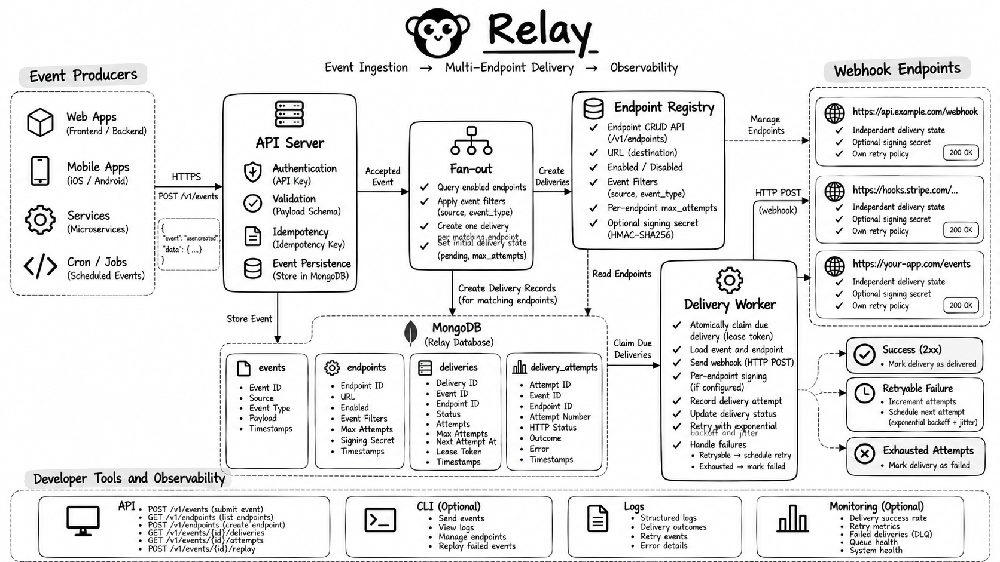

<p align="center">
  
</p>

<h1 align="center">Relay</h1>

<p align="center">
  Reliable webhook delivery for Go applications.
</p>

<p align="center">
  <a href="https://github.com/rajputomsingh/relay/stargazers"></a>
  <a href="https://github.com/rajputomsingh/relay/blob/main/LICENSE"></a>
  
  
</p>

> **Release status:** The latest published release is **v0.4.0 — Multi-Endpoint Delivery** ([tag](https://github.com/rajputomsingh/relay/releases/tag/v0.4.0)). The `main` branch contains later development, including per-endpoint rate limiting and the v0.9.0 load, capacity, and recovery validation milestone. Those capabilities are on `main` but **not** in the v0.4.0 artifact.

Relay accepts events over HTTP, persists them in MongoDB, and delivers them asynchronously to matching webhook endpoints with retries, delivery tracking, and replay. Ingestion and delivery are separate stages so the ingest path stays fast and predictable while the delivery engine applies backoff, concurrency limits, and recovery independently.

- **Runtime:** Go
- **Persistence:** MongoDB 7 (Go Driver v2)
- **Delivery:** Bounded workers, retries with backoff, per-endpoint state
- **Operations:** Delivery history, health checks, graceful shutdown, failure recovery

## Quick Start

```bash
git clone https://github.com/rajputomsingh/relay.git
cd relay
go mod download
```

Configure `.env` from `.env.example` (see [Configuration](#configuration)), then:

```bash
go run ./cmd/relay
```

Validate changes with the full gate:

```bash
go test ./...
go vet ./...
go build ./...
git diff --check
```

## Architecture

<p align="center">
  
</p>

Each accepted event flows through five stages:

1. **Ingestion.** `POST /v1/events` authenticates the caller, validates the JSON body, and enforces `Idempotency-Key`.
2. **Persistence.** Events are written to MongoDB before any delivery begins. Each matching endpoint gets an independent delivery record.
3. **Matching and scheduling.** Enabled endpoints are filtered by `source` and `event_type`. Matching deliveries enter the pending pool.
4. **Bounded delivery workers.** Workers claim deliveries with lease tokens, execute the outbound HTTP request, and record the attempt.
5. **Outcome and recovery.** Attempts resolve to success, retry with backoff, or terminal failure. Expired leases are reclaimed; terminal failures are eligible for replay.

## Delivery Semantics

Relay provides **at-least-once** delivery. It does **not** guarantee exactly-once processing — a successful HTTP response plus a persisted attempt record cannot jointly guarantee a single downstream effect. Any downstream requiring single-effect semantics must key idempotency on the event `id`.

- **Idempotency keys.** The `Idempotency-Key` header rejects duplicate submissions of the same logical event. It prevents duplicate ingestion; it does not prevent duplicate delivery attempts.
- **Retry classification.** Relay retries `5xx`, network errors, connection refusals, and timeouts. `4xx` other than `408` and `429` are terminal.
- **Worker crash.** If a worker dies mid-attempt, its lease expires and the delivery is reclaimed. The retry after reclamation is logged as a new attempt. Downstreams may see a delivery more than once.
- **Lease fencing.** A stale worker attempting to record an outcome after its lease is reclaimed is rejected, so stale results cannot overwrite current state.
- **Downstream idempotency.** Because duplicate delivery is possible, downstream handlers **must** be idempotent.

## Configuration

Relay is configured entirely through environment variables, read at startup; validation failures abort the process.

| Variable                       | Required | Default       | Notes                                    |
| ------------------------------ | -------- | ------------- | ---------------------------------------- |
| `APP_ENV`                      | No       | `development` | `development` / `staging` / `production` |
| `PORT`                         | No       | `8080`        | Valid TCP port                           |
| `MONGODB_URI`                  | Yes      | —             | Must parse as a MongoDB URI              |
| `MONGODB_DATABASE`             | No       | `relay`       | Non-empty                                |
| `RELAY_API_KEY`                | Yes      | —             | Validated for minimum length             |
| `RELAY_WEBHOOK_URL`            | No       | —             | First-run bootstrap only                 |
| `RELAY_WEBHOOK_SIGNING_SECRET` | No       | —             | If set, at least 32 characters           |

`.env` and files containing credentials must never be committed. In production, source these from a secrets manager.

## API Contract

All `/v1/*` routes require `Authorization: Bearer <RELAY_API_KEY>`.

| Method   | Endpoint                     | Auth | Purpose                           |
| -------- | ---------------------------- | ---- | --------------------------------- |
| `GET`    | `/healthz`                   | No   | Liveness (process running)        |
| `GET`    | `/readyz`                    | No   | Readiness (MongoDB reachable)     |
| `POST`   | `/v1/events`                 | Yes  | Submit an event                   |
| `POST`   | `/v1/events/{id}/replay`     | Yes  | Replay an eligible failed event   |
| `POST`   | `/v1/endpoints`              | Yes  | Register an endpoint              |
| `GET`    | `/v1/endpoints`              | Yes  | List endpoints                    |
| `GET`    | `/v1/endpoints/{id}`         | Yes  | Retrieve one endpoint             |
| `PATCH`  | `/v1/endpoints/{id}`         | Yes  | Update endpoint configuration     |
| `DELETE` | `/v1/endpoints/{id}`         | Yes  | Disable an endpoint (soft delete) |
| `GET`    | `/v1/events/{id}/deliveries` | Yes  | Per-endpoint delivery status      |
| `GET`    | `/v1/events/{id}/attempts`   | Yes  | Attempt history                   |

Common status codes: `400` malformed request, `401` missing/invalid API key, `404` not found, `409` idempotency or replay conflict, `422` validation failure, `5xx` internal (safe to retry with the same idempotency key). Error responses use:

```json
{ "error": "invalid_request", "message": "human-readable description" }
```

**Submit an event**

```http
POST /v1/events
Authorization: Bearer YOUR_RELAY_API_KEY
Content-Type: application/json
Idempotency-Key: payment-1001
```

```json
{
  "source": "payments-service",
  "event_type": "payment.completed",
  "data": { "order_id": "order-1001", "amount": 1499, "currency": "INR" }
}
```

Success returns `202 Accepted`:

```json
{ "id": "01HX7K8QW3M5N2P4R6T8V0Z2X4" }
```

**Register an endpoint**

```http
POST /v1/endpoints
Authorization: Bearer YOUR_RELAY_API_KEY
Content-Type: application/json
```

```json
{
  "url": "https://example.com/webhooks",
  "event_filter": {
    "source": "payments-service",
    "event_type": "payment.completed"
  },
  "signing_secret": "at-least-32-characters-of-entropy-here",
  "max_attempts": 6
}
```

Success returns `201 Created`:

```json
{ "id": "01HX7M4KJ3P2Q5R8S9T0U1V2W3" }
```

## Webhook Signing

When an endpoint has a signing secret, Relay signs outbound requests with `HMAC-SHA256` over the raw body and sends the hex digest in `X-Relay-Signature`.

**Verify in Go**

```go
func verifyRelaySignature(rawBody []byte, header string, secret []byte) error {
    if header == "" {
        return errors.New("missing X-Relay-Signature")
    }
    mac := hmac.New(sha256.New, secret)
    mac.Write(rawBody)
    expected := hex.EncodeToString(mac.Sum(nil))
    if !hmac.Equal([]byte(header), []byte(expected)) {
        return errors.New("signature mismatch")
    }
    return nil
}
```

**Verify in Node.js**

```js
function verifyRelaySignature(rawBody, header, secret) {
  if (!header) throw new Error("missing X-Relay-Signature");
  const expected = crypto
    .createHmac("sha256", secret)
    .update(rawBody)
    .digest("hex");
  const a = Buffer.from(header, "utf8");
  const b = Buffer.from(expected, "utf8");
  if (a.length !== b.length || !crypto.timingSafeEqual(a, b)) {
    throw new Error("signature mismatch");
  }
}
```

**Verify in Python**

```python
def verify_relay_signature(raw_body: bytes, header: str, secret: bytes) -> bool:
    if not header:
        raise ValueError("missing X-Relay-Signature")
    expected = hmac.new(secret, raw_body, hashlib.sha256).hexdigest()
    return hmac.compare_digest(header, expected)
```

Notes:

- The signature covers the **raw request body**. Read and verify before any JSON parser touches it, or capture the raw bytes for verification.
- The current protocol has no timestamp or nonce. Replay protection is downstream responsibility — for example, by rejecting events whose `id` has already been processed.
- Rotate the secret through your secret manager and update it via `PATCH /v1/endpoints/{id}`.

## Delivery Attempt History

Attempts are stored in the MongoDB `delivery_attempts` collection.

| Field            | Purpose                         |
| ---------------- | ------------------------------- |
| `event_id`       | Associated event                |
| `endpoint_id`    | Associated webhook endpoint     |
| `attempt_number` | Attempt sequence number         |
| `started_at`     | Attempt start time              |
| `finished_at`    | Attempt completion time         |
| `duration_ms`    | Attempt duration                |
| `http_status`    | HTTP status when available      |
| `outcome`        | Delivery outcome                |
| `error`          | Failure details when applicable |

An index on `event_id` and descending `started_at` supports retrieving recent attempts. Attempt-history write failures are logged separately so they cannot overwrite the primary delivery result.

## Operations

- **Health.** `/healthz` returns `200` while the process runs. `/readyz` returns `200` only when MongoDB responds to ping.
- **Shutdown.** On `SIGINT`/`SIGTERM`, Relay stops accepting new requests, drains in-flight deliveries up to the shutdown deadline, then exits. Deliveries cut short by the deadline have their leases expire and are reclaimed.
- **Lease recovery.** Pending deliveries hold a lease token and expiry. If a worker fails, the lease expires and the delivery is reclaimed; the retry is a new attempt.
- **Retry policy.** Backoff is `retryDelay(n) = 2s × 2^(n-1) + jitter(0–25%)`, capped per delay and bounded by `max_attempts`. Exhausted attempts move the delivery to a terminal `failed` outcome eligible for manual replay.
- **Observability.** Persisted attempts and structured logs are the primary surface. A first-class metrics endpoint is on the roadmap. Query `delivery_attempts` and logs for outcome distribution, per-endpoint failure rate, `duration_ms` percentiles, and pending backlog.
- **Deployment.** Supply `MONGODB_URI`, `MONGODB_DATABASE`, and `RELAY_API_KEY` via a secret manager. Relay creates required indexes on startup. Run under a process supervisor with restart-on-exit and wire health/readiness probes to `/healthz` and `/readyz`.

### Troubleshooting

| Symptom                              | Likely cause                             | Check                                       |
| ------------------------------------ | ---------------------------------------- | ------------------------------------------- |
| Backlog grows unboundedly            | Unhealthy downstream or backoff too high | `delivery_attempts` outcomes and `error`    |
| Deliveries succeed, attempts missing | History-write failure                    | Logs for attempt-history persistence errors |
| New submissions rejected with `401`  | API key mismatch                         | `RELAY_API_KEY` on both sides               |
| `/readyz` returns `503`              | MongoDB unreachable                      | `MONGODB_URI`, network reachability         |

## Security Model

**Enforced by Relay:**

- Bearer API-key authentication on `/v1/*`.
- JSON input validation with explicit rejection of malformed payloads.
- Idempotency-key enforcement against duplicate submissions.
- `HMAC-SHA256` outbound signing when a per-endpoint secret is configured.
- Secret redaction in logs.

**Deployment responsibilities:**

- **Transport security.** HTTPS termination in front of Relay for externally reachable endpoints.
- **SSRF protection.** Relay stores endpoint URLs as registered. Rejecting private, loopback, and link-local targets — at registration time or via network egress policy — is the operator's responsibility.
- **Redirects.** Relay does not follow HTTP redirects by default. Apply the same expectation to downstream systems and monitor for DNS rebinding.
- **Secret rotation.** Rotating `RELAY_API_KEY` and per-endpoint signing secrets is an operational procedure.
- **MongoDB least privilege.** Relay should run under a role scoped to its own database with restricted network access.
- **Alerting.** Sustained delivery failure or backlog growth detection is an operator concern until Relay exposes first-class metrics.

API-key authentication alone is not a complete production security model. Deployment-specific controls remain necessary.

## Benchmarks

Relay includes a benchmark harness for sustained load, concurrency, failure modes, outage recovery, and queue growth. Full methodology and raw results: [docs/benchmarks.md](docs/benchmarks.md).

All numbers are from a single Windows host with Go 1.27.0 and MongoDB 7 in Docker — measurements of that environment, **not** universal production-capacity claims.

| Measurement                 | Result                               |
| --------------------------- | ------------------------------------ |
| Workload                    | 5,000 deliveries                     |
| Highest tested concurrency  | 32                                   |
| Highest reported throughput | 43.5 deliveries/s                    |
| Highest-concurrency drain   | 115 s                                |
| Environment                 | Windows, Go 1.27.0, MongoDB 7 Docker |

Sustained-load results excerpt:

| Behavior | Concurrency | Drain (s) | Throughput (deliv/s) |
| -------- | ----------: | --------: | -------------------: |
| fast     |           8 |       142 |                 35.2 |
| fast     |          16 |       127 |                 39.4 |
| fast     |          32 |       115 |                 43.5 |
| slow     |          32 |       136 |                 36.8 |

Throughput plateaus at concurrency 8; doubling to 16 adds 12%, doubling to 32 adds 10%. MongoDB was not the bottleneck — connections stayed well under the driver pool of 100 and insert/query/update counts matched the expected workload shape. The ceiling is CPU-bound work in the worker process.

Measurement boundaries: single host, harness poll interval 200ms (faster than the production default of 2s), throughput counts terminal outcomes, drain measured from first submission to last terminal outcome.

## Known Limitations

- No Prometheus/OpenTelemetry metrics endpoint.
- No tenant isolation or per-tenant authorization.
- No web UI for event inspection, monitoring, or replay.
- No published OpenAPI specification.
- End-to-end suite is not yet automated across every route; handler and delivery-package integration tests exist.
- No Dockerfile or compose manifest.

## Project Status and Roadmap

**In progress**

- Production-focused security review: endpoint URL validation and SSRF guidance.
- End-to-end integration and failure-recovery test suite.

**Planned**

- Deployment docs, containerization, and operational runbooks.
- Release automation and repeatable release validation.
- First-class metrics and alerting surface.
- Tenant isolation and per-tenant authorization.
- Web dashboard for event inspection and replay.

Tracked under the `v1.0.0 — Production Readiness` milestone. Items marked planned stay that way until verified by code and tests.

## Project Structure

```text
relay/
├── cmd/relay/          # entrypoint: config, DB, HTTP server, delivery worker
├── internal/
│   ├── config/         # env loading and validation
│   ├── database/       # MongoDB client, indexes, collections
│   ├── delivery/       # worker loop, leases, retries, backoff, attempts
│   ├── endpoints/      # endpoint CRUD and matching
│   ├── handlers/       # HTTP routing, auth, validation, responses
│   └── security/       # API key checks, HMAC signing, URL validation
├── bench/              # benchmark harness
├── docs/               # methodology and detailed documentation
├── .env.example
├── CONTRIBUTING.md
├── LICENSE
├── go.mod
└── README.md
```

## Development and Testing

**Unit tests (no infrastructure):**

```bash
go test ./internal/config ./internal/security ./internal/handlers -count=1
```

**Integration tests (MongoDB required):**

```bash
export MONGODB_TEST_URI="mongodb://localhost:27017"
go test ./internal/delivery -count=1
```

If `MONGODB_TEST_URI` is unset or MongoDB is unreachable, these tests skip cleanly rather than fail.

**Full validation gate (before proposing changes):**

```bash
go test ./...
go vet ./...
go build ./...
git diff --check
```

End-to-end tests spanning the full accept → persist → deliver → retry → recover cycle are not yet automated; they are exercised by the benchmark harness and manual verification.

## Contributing

Read [CONTRIBUTING.md](CONTRIBUTING.md) before submitting a pull request. Run the full validation gate above before opening a PR.

## License

Licensed under the Apache License 2.0. See [LICENSE](LICENSE) for details.
